 <!-- ====================================================== -->
<!--              AMITH M. SHETTY - GITHUB README          -->
<!-- ====================================================== -->

# 👋 Hello, World! I'm Amith

### Developer | AI & ML Enthusiast | Automation Explorer

 

---

## 👨‍💻 About Me

Hey! I'm **Amith M. Shetty**, a passionate developer from India 🇮🇳.

I enjoy exploring new technologies, creating digital experiences, experimenting with automation, and turning ideas into practical solutions.

- 🔭 Currently working on **[Laundrix](https://github.com/Amith-x42/laundry)**
- 🌱 Learning **Artificial Intelligence, Machine Learning & Automation**
- 💡 Interested in **Web Development, Robotics & Emerging Technologies**
- 👨‍💻 My projects: **[Personal Portfolio](https://amith-portfolio-x42.netlify.app/)**
- 💬 Ask me about **Web Development & Robotics**
- 📫 Email: **amithmshetty552004@gmail.com**
- ⚡ Fun fact: I'm a **Multipotentialite** — curious about many different fields!

---

## 🌐 Connect With Me

---

## 🛠️ Tech Stack & Tools

### 💻 Programming Languages

### 🌐 Web Development

### 🗄️ Database & Data Analytics

### 🤖 Robotics, AI & Cloud

### 🎨 Design & Development Tools

---

## 🚀 Featured Projects

<table>
<tr>
<td width="50%" valign="top">

### 🧺 Laundrix

A laundry management application currently under development.

</td>
<td width="50%" valign="top">

### 📊 Customer Behavior Analysis

A project focused on analyzing customer behavior and exploring data insights.

</td>
</tr>

<tr>
<td width="50%" valign="top">

### 🎵 Global Music Trends

A project exploring global music trends through data analysis.

</td>
<td width="50%" valign="top">

### 💻 Personal Portfolio

My personal website showcasing my projects, skills, and development journey.

</td>
</tr>

<tr>
<td width="50%" valign="top">

### 🏋️ Gym Management

A software project focused on gym management.

</td>
<td width="50%" valign="top">

### ✨ More Projects

Discover more experiments, applications, and projects from my development journey.

</td>
</tr>
</table>

---

## 📊 GitHub Analytics

---

## 📈 Contribution Activity

---

## 🐍 Contribution Snake

---

## 🏆 GitHub Achievements

---

## 💭 A Little Motivation

### "Great things are built by people who never stop learning."

🚀 Keep Building. Keep Exploring. Keep Growing.

 

**Thanks for visiting my GitHub profile!**

If you like my work, don't forget to ⭐ my repositories.

  

<!-- ====================================================== -->
<!--                    END OF README                      -->
<!-- ====================================================== -->
